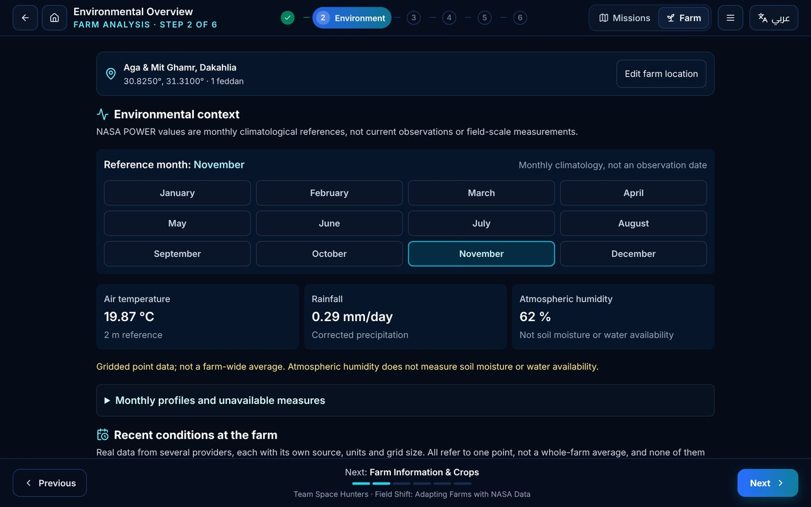
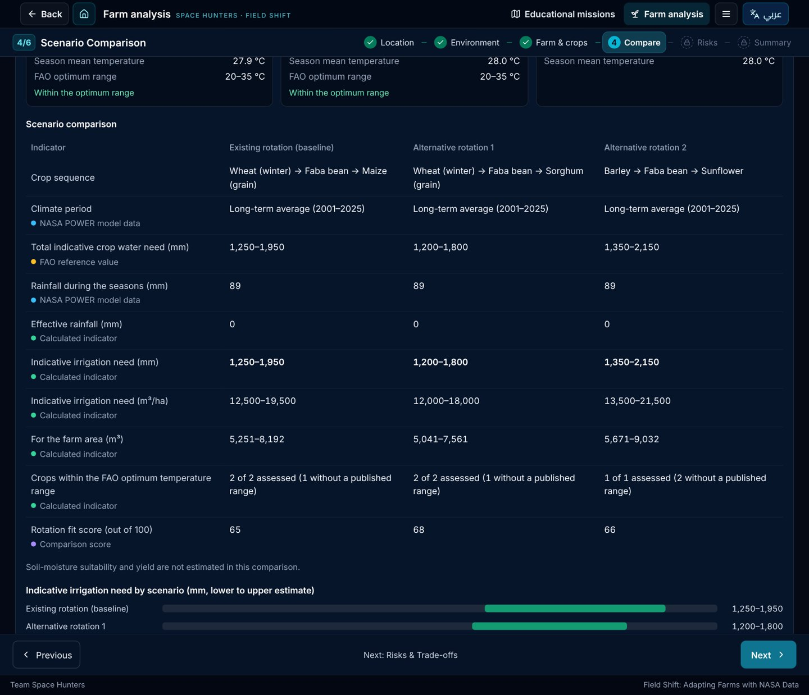
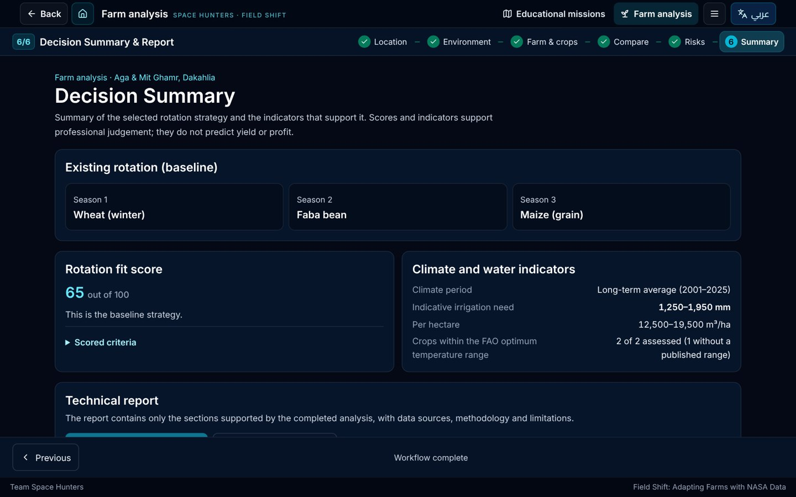
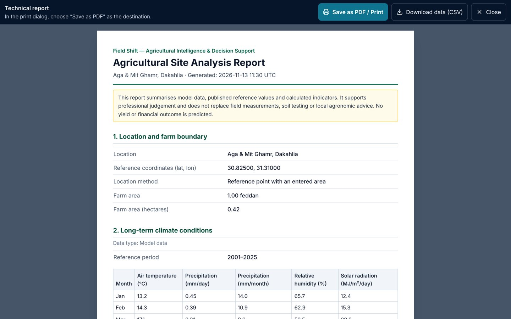
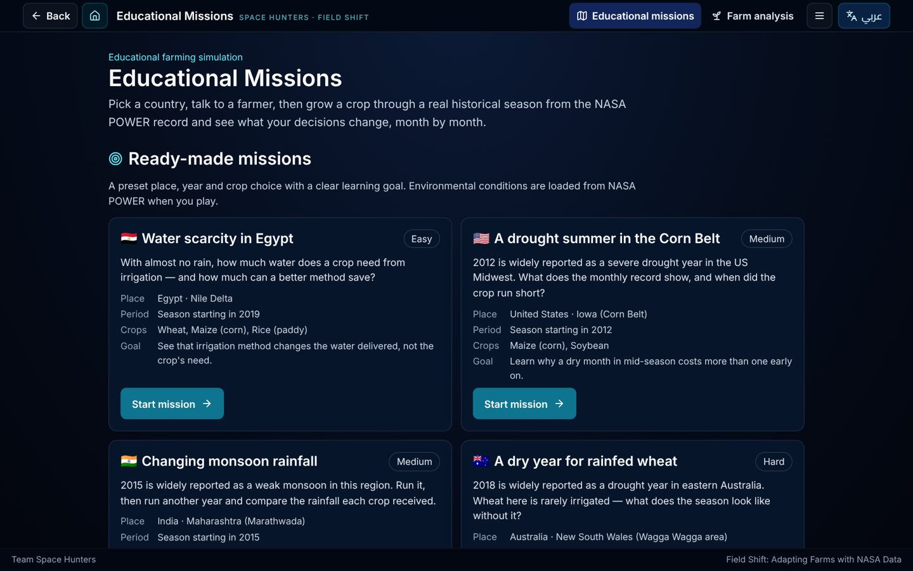

# Field Shift — Agricultural Intelligence & Decision Support

**NASA Space Apps Challenge 2026 · Cairo** — Challenge: *Field Shift: Adapting Farms with NASA Data* — Team: **Space Hunters**

Field Shift is a bilingual (English and Arabic) web tool that helps agricultural engineers, consultants, agricultural companies and decision-makers compare crop rotation options for a specific farm location, using NASA Earth observation data and published FAO methods.

- **Live website:** https://space-hunters-field-shift.vercel.app
- **Repository:** https://github.com/MGehad/Space-Hunters-Field-Shift


## Contents

- [What Field Shift does](#what-field-shift-does)
- [Screenshots](#screenshots)
- [How it works](#how-it-works)
- [Data sources](#data-sources)
- [Types of information](#types-of-information)
- [Current limitations](#current-limitations)
- [Technology](#technology)
- [Getting started](#getting-started)
- [Project structure](#project-structure)
- [Team](#team)
- [References](#references)

## What Field Shift does

Deciding which crops to grow, and in what order, depends on local climate, soil and water. This information exists, but it is spread across satellite archives, climate databases, soil surveys and technical manuals. Field Shift brings it into one workflow.

The website has two separate parts, both opened from the home page:

| Part | For whom | What it does |
|---|---|---|
| **Farm Analysis & Planning** | Agricultural professionals | Analyses one farm location, compares three crop rotations and exports a report |
| **Educational Missions** | Learners | Simulates a crop season in six countries with real NASA POWER data |

Field Shift is honest about what it shows. Values are labelled as observations, model estimates or calculated indicators, and missing data are shown as "unavailable" instead of being invented. **Field Shift does not forecast yield or profit.**

## Screenshots

The data screens below show real NASA POWER values for the default reference point in the Nile Delta, Egypt (30.825° N, 31.31° E).

### Environmental overview

Long-term monthly climate for the farm point from NASA POWER, followed by the "Recent conditions" section.



### Scenario comparison

The existing rotation and two alternatives, side by side. Each row shows its data type (model data, FAO reference value or calculated indicator). Yield and soil-moisture suitability are shown as not estimated.



### Decision summary

The selected rotation, its score and its climate and water indicators.



### Technical report

The report can be saved as a PDF through the browser's print dialog, or downloaded as a CSV file, in English or Arabic.



### Educational Missions

A separate learning experience with ready-made missions and a free simulation.



### Arabic interface

The whole site is available in Arabic with a right-to-left layout.


## How it works

### Farm Analysis & Planning

The user moves through six steps in order:

**Location & Farm Boundary → Environmental Overview → Farm Information & Crops → Scenario Comparison → Risks & Trade-offs → Decision Summary & Report**

1. **Select the location.** Search for any place name worldwide, use **My location** (the browser asks for permission), type coordinates, click a point on a satellite map, or draw the farm boundary as a polygon. The boundary is validated (at least three points) and its area is calculated on a spherical Earth model. The area can also be entered in hectares or feddans.
2. **Collect environmental data.** The application requests climate, vegetation, evapotranspiration and soil data for the farm point (see [Data sources](#data-sources)).
3. **Process the data.** A shared request layer handles time-outs, retries and caching. Units are converted, fill values are removed, low-quality NDVI pixels are filtered, and missing or incomplete months are marked instead of being filled.
4. **Describe the crops.** Enter the existing rotation and two alternatives from a catalog of ten field crops. Each crop has published FAO values: indicative seasonal water need, growing period and optimum temperature range, plus its plant family.
5. **Score the rotations.** Each rotation gets a score from 0 to 100 from four weighted criteria: lower crop water need, nitrogen-fixing potential (share of legumes), crop-family diversity and potential pest-cycle breaks. The weights can be changed. Criteria with no reliable data are shown as "not scored".
6. **Compare scenarios with the climate.** For each crop season, set a planting month and season length, and choose the long-term average or a specific recent year. Field Shift sums the season rainfall, converts it to effective rainfall, and subtracts it from the crop water need to give an indicative irrigation range in mm and m³/ha. It also checks whether the season's mean temperature is inside the crop's optimum range.
7. **Report risks, limits and the decision.** The risk step lists the available evidence for water, heat and vegetation stress without giving probabilities. The same step shows a short note on how complete the data are. The decision summary exports everything as a report.

**Effective rainfall (FAO):**

```
Pe = 0.8 × P − 25    when monthly rainfall P > 75 mm
Pe = 0.6 × P − 10    when monthly rainfall P ≤ 75 mm   (never below 0)
```

### Educational Missions

The player chooses one of six countries (Egypt, India, the United States, Brazil, Australia or Spain), one of seven crops, a planting year and month, and irrigation decisions. The simulation loads real NASA POWER monthly data for that season and calculates a monthly water balance with FAO methods:

- Blaney–Criddle reference evapotranspiration
- FAO-56 crop coefficients
- Effective rainfall
- A simple soil water store
- The FAO yield-response factor (Ky)

The result is a **relative yield** compared with a fully watered crop, not a yield forecast. Experiments can be saved in the browser, and two of them can be compared.

## Data sources

All data are requested directly from public services in the browser. There is no server database, no user account and no API key.

| Source | Provider | Used for | Coverage |
|---|---|---|---|
| [NASA POWER](https://power.larc.nasa.gov/docs/) climatology and monthly APIs (MERRA-2 based) | NASA | Temperature, precipitation, humidity, solar radiation | Global |
| [MOD13Q1 v061](https://doi.org/10.5067/MODIS/MOD13Q1.061) NDVI, 250 m, 16-day, through the [ORNL DAAC subset service](https://modis.ornl.gov/data/modis_webservice.html) | NASA | Vegetation greenness | Global |
| ERA5 reanalysis through the [Open-Meteo Historical Weather API](https://open-meteo.com/en/docs/historical-weather-api) | ECMWF / Copernicus (not NASA) | Reference evapotranspiration, soil moisture | Global |
| SSURGO soil survey through [Soil Data Access](https://sdmdataaccess.nrcs.usda.gov/) | USDA NRCS | Soil properties | United States only |
| FAO reference tables | FAO | Crop water needs, growing periods, crop coefficients, temperature ranges, yield response | General values |
| Esri World Imagery | Esri | Background map only (not used in calculations) | Global |
| Nominatim place search | OpenStreetMap | Finding a place by name and naming the "My location" point (not used in calculations) | Global |

Other NASA missions such as SMAP, GPM, Landsat, GRACE-FO and ECOSTRESS are described in the in-app guide for information only. They are **not** connected as data sources.

## Types of information

| Type | In Field Shift | Note |
|---|---|---|
| Directly observed | MODIS NDVI (satellite); USDA soil survey (US only) | NDVI shows the greenness of a 250 m pixel. It is not a yield measurement. |
| Model-based estimates | NASA POWER climate; ERA5 evapotranspiration and soil moisture | Grid cells are tens of kilometres wide. Values are not field measurements. |
| Derived indicators | Effective rainfall, indicative irrigation need, temperature fit, rotation score | Calculated by Field Shift with published formulas. |
| General agricultural knowledge | FAO crop water needs, growing periods, temperature ranges; crop families | General reference values, not local or variety-specific. |
| User-provided information | Location, boundary, area, crops, planting months, season lengths, weights | Results depend on these inputs. |

## Current limitations

- Yield, profit and market prices are not estimated.
- Soil survey data are available only for the United States; elsewhere the soil section shows "unavailable".
- Climate values describe a large grid cell, and monthly data cannot show short dry spells.
- Field Shift supports expert judgement. It does not replace field measurements or local extension advice.

## Technology

- **Framework:** Next.js 14 (App Router), React 18, JavaScript
- **Styling:** Tailwind CSS 3, clsx, tailwind-merge, lucide-react icons
- **Maps:** Leaflet 1.9 (farm map and boundary drawing); d3-geo, topojson-client and world-atlas (world map)
- **Fonts:** Inter and Cairo, self-hosted
- **Tests:** Node.js built-in test runner
- **Reports:** browser print-to-PDF and CSV download; no extra library

## Getting started

Requires Node.js 18 or later.

```bash
git clone https://github.com/MGehad/Space-Hunters-Field-Shift.git
cd space-hunters
npm install
npm run dev
```

Open http://localhost:3000 in your browser. An internet connection is needed, because the data come from the public services listed above.

Production build:

```bash
npm run build
npm run start
```

Unit tests:

```bash
npm run test:data
```

## Project structure

```
src/
  app/                 Page, layout, global styles, fonts
  components/
    farmPro/           Location, boundary, environmental overview, recent conditions
    rotation/          Rotation strategies and scenario comparison
    report/            Printable report view
    game/              Educational Missions screens
    map/               World map
  analysis/
    rotation/          Rotation scoring
    scenario/          Effective rainfall and irrigation need
    risk/              Environmental risk screening
    uncertainty/       Data completeness assessment
  services/
    nasa/              NASA POWER and MODIS NDVI
    era5/              ERA5 through Open-Meteo
    usda/              SSURGO soil data
    data/              Shared request layer (time-outs, retries, caching)
  game/                Simulation engine, countries, crops and missions
  reports/             Report builder and CSV export
  data/                Crop catalog, guide content, translations
tests/                 Unit tests
```

## Team

**Space Hunters** — NASA Space Apps Cairo 2026

| Member | Role |
|---|---|
| Ahmed Farid Elgohary Attia | Team lead, coordination and video editing |
| Mohamed Gehad Hussien Metwali | Front-end development, UI/UX and testing |
| Ahmed Mohamed Salah El-Din Abdul Khaleq | Front-end development, testing and localization |
| Ibrahim Mohamed Asker | Agricultural research |
| Shehab Medhat Mohamed Younis | Agricultural research & Presenting |


## References

1. Bowles, T. M., Mooshammer, M., Socolar, Y., et al. (2020). Long-term evidence shows that crop-rotation diversification increases agricultural resilience to adverse growing conditions in North America. *One Earth*, 2(3), 284–293. https://doi.org/10.1016/j.oneear.2020.02.007
2. Huete, A., Didan, K., Miura, T., Rodriguez, E. P., Gao, X., & Ferreira, L. G. (2002). Overview of the radiometric and biophysical performance of the MODIS vegetation indices. *Remote Sensing of Environment*, 83(1–2), 195–213. https://doi.org/10.1016/S0034-4257(02)00096-2
3. Gelaro, R., McCarty, W., Suárez, M. J., et al. (2017). The Modern-Era Retrospective Analysis for Research and Applications, Version 2 (MERRA-2). *Journal of Climate*, 30(14), 5419–5454. https://doi.org/10.1175/JCLI-D-16-0758.1
4. Hersbach, H., Bell, B., Berrisford, P., et al. (2020). The ERA5 global reanalysis. *Quarterly Journal of the Royal Meteorological Society*, 146(730), 1999–2049. https://doi.org/10.1002/qj.3803
5. Jones, J. W., Hoogenboom, G., Porter, C. H., et al. (2003). The DSSAT cropping system model. *European Journal of Agronomy*, 18(3–4), 235–265. https://doi.org/10.1016/S1161-0301(02)00107-7
6. Sparks, A. H. (2018). nasapower: A NASA POWER Global Meteorology, Surface Solar Energy and Climatology Data Client for R. *Journal of Open Source Software*, 3(30), 1035. https://doi.org/10.21105/joss.01035
7. Brouwer, C., & Heibloem, M. (1986). *Irrigation Water Management: Irrigation Water Needs* (Training Manual No. 3). FAO, Rome. https://www.fao.org/4/S2022E/s2022e08.htm
8. Allen, R. G., Pereira, L. S., Raes, D., & Smith, M. (1998). *Crop Evapotranspiration: Guidelines for Computing Crop Water Requirements* (FAO Irrigation and Drainage Paper 56). FAO, Rome. https://www.fao.org/4/X0490E/x0490e0b.htm
9. FAO (1985). *Guidelines: Land Evaluation for Irrigated Agriculture* (FAO Soils Bulletin 55). FAO, Rome. https://www.fao.org/4/x5648e/x5648e0e.htm
10. Didan, K. (2021). *MODIS/Terra Vegetation Indices 16-Day L3 Global 250m SIN Grid V061* [Data set]. NASA LP DAAC. https://doi.org/10.5067/MODIS/MOD13Q1.061
